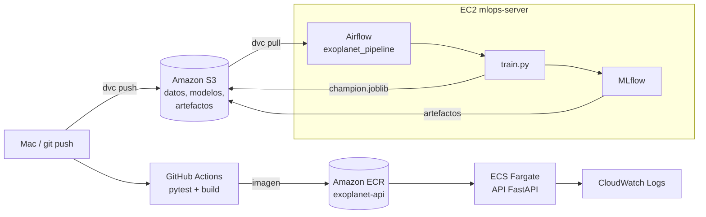

# Clasificador de Exoplanetas Kepler — Proyecto MLOps

API que clasifica objetos de interés de Kepler (KOI) como **CONFIRMED** (planeta confirmado) o **FALSE POSITIVE**, con todo el ciclo de MLOps: versionado de datos, pruebas, CI/CD, contenedores, autoescalado con Kubernetes, seguimiento de experimentos, orquestación y despliegue en **AWS**.

> Modelo con fines didácticos. No debe usarse para decisiones científicas reales.

**Autora:** Mafer González · Ingeniería en Informática, CUCEI (UdeG)
**Evidencias:** [`docs/Proyecto_MLOps_Exoplanetas_Completo.pdf`](docs/Proyecto_MLOps_Exoplanetas_Completo.pdf)

## Recorrido del proyecto

| Etapa | Qué se hizo | Dónde está |
|---|---|---|
| Práctica 8 — CI/CD | API FastAPI, pruebas con pytest, imagen Docker y GitHub Actions | `app/`, `tests/`, `Dockerfile`, `.github/workflows/` |
| Práctica 9 — Monitoreo | Detección de drift de datos y predicciones con Evidently AI | proyecto aparte `exoplanet-monitoring` (ver PDF) |
| Kubernetes | Autoescalado de la API con HPA bajo prueba de carga | [`k8s/`](k8s/README.md) |
| AWS | S3 + DVC, ECR, ECS/Fargate, CloudWatch, CI/CD a ECR | `.dvc/`, `ecs-task.json`, `.github/workflows/cicd.yml` |
| MLflow + Airflow en EC2 | Experimentos y orquestación del entrenamiento en la nube | `train.py`, `dags/`, `deploy/setup_ec2.sh` |

## Arquitectura en AWS (us-east-2)



| Servicio | Uso |
|---|---|
| **S3** | Bucket `mafer-exoplanetas-mlops-<cuenta>`: dataset (remote de DVC), modelo y artefactos de MLflow |
| **ECR** | Repositorio privado `exoplanet-api`; GitHub Actions publica `latest` y el SHA de cada commit |
| **ECS + Fargate** | Clúster `exoplanet-cluster`, servicio `exoplanet-service` (0.25 vCPU, 1 GB) — ver `ecs-task.json` |
| **CloudWatch** | Log group `/ecs/exoplanet-api` con los logs de la API |
| **EC2** | `mlops-server` (m7i-flex.large, Ubuntu 24.04) con MLflow y Airflow como servicios de systemd |
| **IAM** | Usuario `mafer-mlops` para la CLI; rol `mlops-ec2-role` con acceso solo al bucket del proyecto |

## Dataset

Kepler Objects of Interest, NASA Exoplanet Archive (9,564 objetos). Versionado con **DVC**: en Git solo está `data/cumulative.csv.dvc` y el archivo real vive en S3.

```bash
python -m dvc pull     # descarga data/cumulative.csv desde S3
```

- **Objetivo:** `koi_disposition` → CONFIRMED (1) vs FALSE POSITIVE (0). Los CANDIDATE se excluyen porque aún no tienen etiqueta confirmada.
- **Variables:** `koi_period`, `koi_duration`, `koi_depth`, `koi_prad`, `koi_teq`, `koi_model_snr`, `koi_steff`, `koi_srad`.
- Se excluyen `koi_score` y `koi_fpflag_*` porque prácticamente revelan la respuesta (fuga de información).
- **Modelo:** `Pipeline(SimpleImputer(median) → RandomForestClassifier)` guardado en `models/champion.joblib`. Accuracy 0.91, F1 0.87, ROC-AUC 0.97.

## Estructura

```
app/main.py                 API FastAPI (/, /health, /docs, /predict)
templates/index.html        Formulario web
models/champion.joblib      Modelo entrenado (lo genera train.py)
train.py                    Entrenamiento + registro en MLflow
tests/                      Pruebas con pytest
Dockerfile                  Imagen de la API
.github/workflows/cicd.yml  CI (pytest) + CD (publicación en Amazon ECR)
data/cumulative.csv.dvc     Dataset versionado con DVC (remote en S3)
k8s/                        Deployment, Service, HPA y prueba de carga
ecs-task.json               Task definition de ECS Fargate
dags/exoplanet_pipeline.py  DAG de Airflow
deploy/setup_ec2.sh         Instala MLflow y Airflow en EC2
docs/                       PDF con todas las evidencias
```

## Ejecución local (macOS)

```bash
python3 -m venv .venv
source .venv/bin/activate
python -m pip install -r requirements.txt
python train.py            # opcional: regenera el modelo
python -m pytest -v        # 4 pruebas deben pasar
python -m uvicorn app.main:app --reload
```

En Windows (CMD) la activación es `.venv\Scripts\activate.bat`.

- http://127.0.0.1:8000/ — formulario
- http://127.0.0.1:8000/docs — documentación interactiva
- http://127.0.0.1:8000/health — `{"status":"ok"}`

JSON de ejemplo para `POST /predict` (Kepler-227 b):

```json
{
  "koi_period": 9.488,
  "koi_duration": 2.958,
  "koi_depth": 615.8,
  "koi_prad": 2.26,
  "koi_teq": 793,
  "koi_model_snr": 35.8,
  "koi_steff": 5455,
  "koi_srad": 0.927
}
```

La respuesta contiene `prediction`, `planet_probability` y `confidence_level`.

## Docker

```bash
docker build -t exoplanet-api:v1 .
docker images
docker run --rm --name exoplanet-api -p 8000:8000 exoplanet-api:v1
```

## CI/CD (GitHub Actions → Amazon ECR)

- **test:** instala dependencias y ejecuta `pytest` en cada push y pull request a `main`.
- **docker:** depende de `test` (`needs: test`). Solo en push a `main`, inicia sesión en AWS con los *secrets* `AWS_ACCESS_KEY_ID` y `AWS_SECRET_ACCESS_KEY`, construye la imagen para `linux/amd64` y la publica en **Amazon ECR** con las etiquetas `latest` y el SHA del commit.

Si las pruebas fallan, el job `docker` queda omitido (*skipped*) y no se publica ninguna imagen.

> En la Práctica 8 la imagen se publicaba en GitHub Container Registry (`ghcr.io`); al pasar a AWS se cambió a ECR.

## Kubernetes

Demostración de autoescalado con Docker Desktop, metrics-server y HPA (de 1 a 5 réplicas). Instrucciones en [`k8s/README.md`](k8s/README.md).

## API en ECS Fargate

```bash
aws ecs register-task-definition --cli-input-json file://ecs-task.json --region us-east-2
aws ecs create-service --cluster exoplanet-cluster --service-name exoplanet-service \
  --task-definition exoplanet-api --desired-count 1 --launch-type FARGATE \
  --network-configuration "awsvpcConfiguration={subnets=[<subnet>],securityGroups=[<sg>],assignPublicIp=ENABLED}" \
  --region us-east-2
```

La API queda en `http://<ip-publica>:8000` y sus logs en CloudWatch (`/ecs/exoplanet-api`). Para no gastar créditos:

```bash
aws ecs delete-service --cluster exoplanet-cluster --service exoplanet-service --force --region us-east-2
```

## MLflow y Airflow en EC2

`train.py` registra parámetros, métricas y el modelo (`exoplanet-champion`) en MLflow; los artefactos se guardan en S3. El DAG `exoplanet_pipeline` orquesta:

```
descargar_datos (dvc pull) → entrenar (train.py + MLflow) → pruebas (pytest) → subir_modelo (S3)
```

Instalación en la instancia (Ubuntu 24.04, con el rol IAM del bucket):

```bash
git clone https://github.com/Mafersita-code/exoplanet-cicd.git
bash exoplanet-cicd/deploy/setup_ec2.sh
```

MLflow (puerto 5001) y Airflow (puerto 8080) no se exponen a internet; se abren con un túnel SSH:

```bash
ssh -i ~/.ssh/mafer-mlops.pem -N -L 8080:localhost:8080 -L 5001:localhost:5001 ubuntu@<ip-publica>
```

- http://localhost:8080 — Airflow (usuario `admin`, contraseña en `~/airflow/simple_auth_manager_passwords.json.generated`)
- http://localhost:5001 — MLflow

Para correrlos en la Mac en lugar de EC2: `mlflow server --backend-store-uri sqlite:///mlflow.db --artifacts-destination s3://<bucket>/mlflow --port 5001` y `EXOPLANET_PYTHON=<ruta del venv>/bin/python airflow standalone` con `AIRFLOW__CORE__DAGS_FOLDER` apuntando a `dags/`.

Al terminar, apagar el servidor:

```bash
aws ec2 stop-instances --instance-ids <id> --region us-east-2
```
